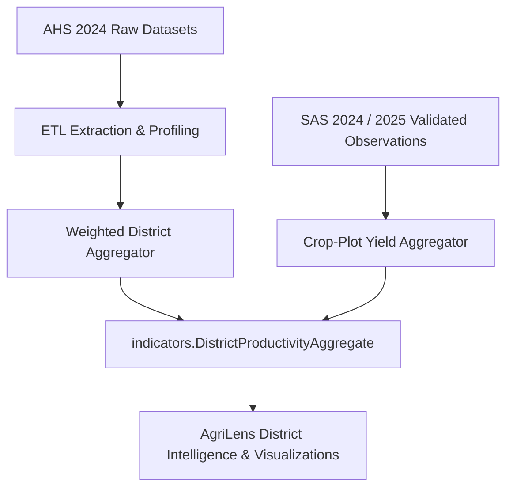

# NISR Agriculture Household Survey (AHS) 2024 Integration Guide

**Platform:** AgriLens — Agricultural Intelligence & Decision-Support Platform for Rwanda  
**Author:** Senior Data Engineering & Agricultural Analytics Team  
**Status:** Approved & Implemented  
**Date:** October 2026  

---

## 1. Overview & Survey Characterization

The **Agriculture Household Survey (AHS) 2024** is conducted by the National Institute of Statistics of Rwanda (NISR) to provide in-depth socioeconomic, structural, and institutional intelligence on agricultural households across Rwanda's 30 districts.

While the Seasonal Agricultural Survey (SAS) focuses on **crop plot yield, seasonal production, and plot-level inputs**, the AHS provides the **human, institutional, and economic foundation** of Rwandan agriculture:
- Household demographics, age, education, and gender of head of household.
- Land tenure, ownership, and land parcel fragmentation.
- Extension service access (advisory visits from RAB, sector agronomists, Farmer Promoters).
- Agricultural credit, savings, and financial inclusion (SACCO, banks, VSLA).
- Livestock inventories and animal health.
- Agricultural assets, farm tools, and storage infrastructure.

---

## 2. Observational Units & Structural Segregation

| Dimension | Seasonal Agricultural Survey (SAS) | Agriculture Household Survey (AHS) | Integration Principle in AgriLens |
| :--- | :--- | :--- | :--- |
| **Primary Unit** | Crop Plot within Enumeration Segment | Agricultural Household (`hhid`) & Individual (`pid`) | Separate relational models (`surveys.Household`, `farmers.FarmerProfile`) |
| **Temporal Frequency** | Tri-annual (Seasons A, B, C) | Annual / Multi-year structural survey | Cross-sectional annual benchmark |
| **Weight Variable** | `plot_weight` (Expansion factor for crop area) | `weight_hh` (Household expansion factor) | Never mix weights; use domain-appropriate weights |
| **Geographic Keys** | District (`s1q2`), Segment (`Segment_ID`) | Province, District (`district`), Sector (`sector`), E.A. | Harmonized via official NISR 2-digit district & sector codes |

> [!CAUTION]  
> **Strict Prohibition on Row-Level Joining:**  
> SAS plot records cannot be linked 1:1 to AHS household records because SAS samples spatial physical segments, whereas AHS samples socio-economic households from census enumeration frames. Joining them on arbitrary spatial IDs would generate artificial, invalid correlations. All integration occurs at the **District, Sector, and Thematic Indicator level**.

---

## 3. High-Value AHS 2024 Thematic Modules & AgriLens Integration

### 3.1. Agricultural Extension & Advisory Reach
- **Source Module:** `AHS2024_Section6_Extension.dta`
- **Key Indicators:**
  - Percentage of agricultural households visited by an agricultural extension officer / agronomist in the last 12 months.
  - Main advisory topics received (CIP crop practices, pest control, fertilizer application, soil conservation).
- **AgriLens Domain Model:** `surveys.ExtensionServiceRecord` linked to `geography.District`.

### 3.2. Financial Inclusion & Agricultural Credit
- **Source Module:** `AHS2024_Section7_Credit.dta`
- **Key Indicators:**
  - Share of agricultural households applying for and receiving agricultural loans.
  - Credit sources: Umurenge SACCO, commercial banks, informal tontines (VSLA).
  - Main purpose of credit (purchasing improved seed/fertilizer, buying land, hiring labor).
- **AgriLens Domain Model:** `indicators.DistrictProductivityAggregate` credit indicators.

### 3.3. Land Tenure & Parcel Fragmentation
- **Source Module:** `AHS2024_Section2_Land_Parcels.dta`
- **Key Indicators:**
  - Average number of parcels per agricultural household.
  - Proportion of land operated under formal registered certificate of land title vs. customary tenure or lease.
  - Gender of registered land owner (female-headed vs. male-headed parcel security).

### 3.4. Livestock & Farm Capital Assets
- **Source Module:** `AHS2024_Section4_Livestock.dta` and `AHS2024_Section5_Assets.dta`
- **Key Indicators:**
  - Tropical Livestock Units (TLU) per household (Girinka cattle program monitoring).
  - Possession of productive assets: spray pumps, drying sheets, modern storage silos.

---

## 4. Harmonized Indicator Integration Pipeline

1. **Extraction:** Read Stata `.dta` with Windows-1252 / latin1 encoding.
2. **Weighting:** Apply `weight_hh` to calculate population-representative percentages:
   $$\text{Extension Coverage (\%)} = \frac{\sum_{i=1}^n \left( W_{\text{hh}, i} \times \mathbb{I}(\text{Visited}_i = 1) \right)}{\sum_{i=1}^n W_{\text{hh}, i}} \times 100\%$$
3. **Storage:** Ingest into `DistrictProductivityAggregate` with `provenance="NISR_AHS_2024"`.
4. **Presentation:** Display alongside SAS yield data in the **Geographic Explorer** and **District Intelligence** dashboards, clearly labeled with data source badges (`NISR SAS 2025` vs. `NISR AHS 2024`).

---

## ⚖️ Intellectual Property, License & Usage Policy

> ### ⚠️ STRICT RESTRICTED USE NOTICE
> **All Rights Reserved © 2026 AgriLens Development Team.**
>
> 1. **Non-Commercial & No Personal Profit:**  
>    No individual, entity, or third party is permitted to use, copy, reproduce, monetize, sub-license, or exploit any portion of this codebase, architecture, machine learning models, algorithms, or visual designs for commercial purposes, revenue generation, or personal financial profit under any circumstances.
>
> 2. **Public Hackathon Visibility Disclaimer:**  
>    Although this repository is publicly accessible solely for the purpose of evaluation, review, and judging during the **2026 NISR Big Data Hackathon (Track 1: Agricultural Productivity)**, public availability does **NOT** constitute an open-source license, public domain dedication, or waiver of intellectual property rights.
>
> 3. **Prohibition of Modifications & Derivative Works:**  
>    Any unauthorized modification, alteration, redistribution, fork, decompilation, reverse-engineering, or derivation of this codebase or its underlying assets is strictly prohibited.
>
> 4. **Exclusive Authorization for NISR:**  
>    Operational utilization, institutional adoption, data integration, and platform deployment are **exclusively and solely permitted for the National Institute of Statistics of Rwanda (NISR)** and its officially designated national agricultural partners.

