# AgriLens Dashboard Navigation Architecture

**Platform:** AgriLens &bull; National Agricultural Intelligence Platform  
**Event:** 2026 NISR Big Data Hackathon &bull; Track 1: Agricultural Productivity  
**Milestone:** Milestone 4: Dashboard Navigation, User Management &amp; Role-Based Access Control  
**Document Version:** 1.0 &bull; October 2026  

---

## 1. Overview & Architectural Principles

The AgriLens navigation system provides an intuitive, responsive, institutional-grade decision-support interface for the National Institute of Statistics of Rwanda (NISR), the Ministry of Agriculture and Animal Resources (MINAGRI), agricultural researchers, district agronomists, and the general public.

### Core Architectural Principles
1. **Official NISR Brand Identity:** Designed with official NISR brand colors (Pantone 2728 C `#005CAB` Royal Blue, Pantone Cyan `#00AEEF`, Pantone 362 C `#46962B` Green, and Pantone 3965 C `#F3EA00` Yellow) on a deep institutional navy (`#001F3B`) foundation.
2. **Alpine.js Reactive Accordions:** Sidebar sections collapse and expand smoothly without page flickering, automatically defaulting to expanded state when the user is within that module.
3. **Role-Based Dynamic Visibility:** Sensitive administrative and data management sections dynamically render only when the authenticated user possesses the appropriate institutional clearance.
4. **Active Route Highlighting:** Current section is highlighted with royal blue background, cyan indicator border, and subtle glow.
5. **Mobile Responsiveness:** Collapsible off-canvas drawer on tablet and mobile viewports (`<= 992px`) driven by lightweight Alpine.js state.

---

## 2. Navigation Hierarchy & Route Structure

```mermaid
graph TD
    A[AgriLens Portal] --> B[Core Intelligence]
    A --> C[Productivity & Yield Gap]
    A --> D[Reports & Bulletins]
    A --> E[Agricultural Domains]
    A --> F[Data Governance]
    A --> G[Institutional Administration]

    B --> B1["National Dashboard (/dashboard/)"]
    B --> B2["Public Portal & Map (/)"]

    C --> C1["Yield Gap Intelligence (/indicators/productivity/)"]
    C --> C2["District Rankings (/indicators/productivity/#rankings)"]

    D --> D1["National Agricultural Report (/dashboard/reports/national/)"]
    D --> D2["District Performance Dossier (/dashboard/reports/district/)"]

    E --> E1["Crops & Seasons (/agriculture/crops/)"]
    E --> E2["Districts & Mapping (/geography/districts/)"]
    E --> E3["Seasonal Surveys (/surveys/)"]
    E --> E4["Farmers & Coops (/farmers/)"]
    E --> E5["Inputs & Subsidies (/inputs/)"]
    E --> E6["Commodity Markets (/markets/)"]
    E --> E7["Developer Data API (/api/)"]

    F --> F1["Data Lineage Hub (/data-management/)"]
    F --> F2["Manual Registry (/data-management/manual/)"]
    F --> F3["Submit Observation (/data-management/manual/new/)"]

    G --> G1["Officers & Roles (/accounts/users/)"]
    G --> G2["Register Officer (/accounts/users/new/)"]
    G --> G3["Security Audit Trail (/accounts/audit-log/)"]
```



---

## 3. Section Catalog & Access Restrictions

| Accordion Section | URL Pattern | View Function | Required Clearance |
| :--- | :--- | :--- | :--- |
| **Core Intelligence** | | | |
| &bull; National Dashboard | `/dashboard/` | `dashboard:overview` | Public &amp; Authenticated |
| &bull; Public Portal &amp; Map | `/` | `dashboard:public_home` | Public &amp; Authenticated |
| **Productivity &amp; Gap** | | | |
| &bull; Yield Gap Intelligence | `/indicators/productivity/` | `indicators:productivity` | Public &amp; Authenticated |
| **Reports &amp; Bulletins** | | | |
| &bull; National Report | `/dashboard/reports/national/` | `dashboard:reports_national` | Public &amp; Authenticated |
| &bull; District Dossier | `/dashboard/reports/district/` | `dashboard:reports_district` | Public / Scoped for District Officers |
| **Agricultural Domains** | | | |
| &bull; Crops &amp; Seasons | `/agriculture/crops/` | `agriculture:crop_list` | Public &amp; Authenticated |
| &bull; Districts &amp; Mapping | `/geography/districts/` | `geography:district_list` | Public / Scoped for District Officers |
| &bull; Seasonal Surveys | `/surveys/` | `surveys:survey_list` | Public &amp; Authenticated |
| &bull; Farmers &amp; Coops | `/farmers/` | `farmers:farmer_list` | Public &amp; Authenticated |
| &bull; Inputs &amp; Subsidies | `/inputs/` | `inputs:input_list` | Public &amp; Authenticated |
| &bull; Commodity Markets | `/markets/` | `markets:market_list` | Public &amp; Authenticated |
| &bull; Developer Data API | `/api/` | `api:api-root` | Public &amp; Authenticated |
| **Data Governance** | | | |
| &bull; Data Lineage Hub | `/data-management/` | `data_management:hub` | `ADMIN`, `NISR_DATA_MANAGER`, `ANALYST` |
| &bull; Manual Registry | `/data-management/manual/` | `data_management:manual_entry_list` | Authenticated Internal Officers |
| &bull; Submit Observation | `/data-management/manual/new/` | `data_management:manual_entry_create` | `ADMIN`, `DATA_ENTRY_OFFICER`, `DISTRICT_OFFICER` |
| **Administration** | | | |
| &bull; Officers &amp; Roles | `/accounts/users/` | `accounts:user_list` | `ADMIN` or Superuser |
| &bull; Register Officer | `/accounts/users/new/` | `accounts:user_create` | `ADMIN` or Superuser |
| &bull; Security Audit Trail | `/accounts/audit-log/` | `accounts:audit_log_list` | `ADMIN` or Superuser |

---

## 4. Alpine.js Client-Side State Management

The sidebar incorporates declarative Alpine.js directives (`x-data`, `x-show`, `x-transition`, `@click`) that bind menu state directly to the active URL:

```html
<aside class="sidebar" 
       x-data="{
           openCore: truetrue,
           openAnalytics: truetrue,
           openReports: truetrue,
           openDomains: truefalse,
           openDataGov: truefalse,
           openSecurity: truefalse,
       }"
       :class="{ 'mobile-active': sidebarOpen }">
```

### Key Interactive Features
- **Auto-Expansion:** Accordion sections matching the current request path open automatically on page load.
- **Independent Toggles:** Users can expand or collapse sections on demand without losing context.
- **Chevron Rotation:** SVG indicator icons animate smoothly 180 degrees using CSS transform transitions.
- **Mobile Drawer:** On viewports under `992px`, the sidebar slides in smoothly over the viewport upon clicking the hamburger toggle (`#mobile-sidebar-toggle`).
