# AgriLens Dashboard Navigation Architecture

**Platform:** AgriLens &bull; National Agricultural Intelligence Platform  
**Event:** 2026 NISR Big Data Hackathon &bull; Track 1: Agricultural Productivity  
**Document Version:** 2.0 &bull; Modular Menu Modernization & Role-Aware Navigation  
**Architecture Source:** [`apps/accounts/menu_config.py`](file:///c:/Users/ndoli/Documents/WEBAPP/agrilens/apps/accounts/menu_config.py)

---

## 1. Overview & Architectural Principles

The AgriLens navigation system provides a decoupled, role-aware, accessible, and responsive decision-support interface for the National Institute of Statistics of Rwanda (NISR), the Ministry of Agriculture and Animal Resources (MINAGRI), agricultural researchers, district agronomists, and the general public.

### Core Architectural Principles
1. **Single Source of Truth (`menu_config.py`):** Navigation structure is completely decoupled from template markup. All menu sections, submenus, icon identifiers, and permissions are declaratively defined in Python.
2. **Deep Copy Immutability:** `get_user_menu(role)` returns an isolated, deep copy of the menu data structure to guarantee request-level immutability across users and concurrent requests.
3. **Official NISR Brand Identity:** Built with official NISR brand colors (Pantone 2728 C `#005CAB` Royal Blue, Pantone Cyan `#00AEEF`, Pantone 362 C `#46962B` Green, and Pantone 3965 C `#F3EA00` Yellow) on a deep institutional navy (`#001F3B`) background.
4. **Dual-State Desktop Navigation (Expanded vs. Collapsed):** Supports both an expanded sidebar (260px) and an icon-only collapsed view (72px) with accessible tooltips and persistence via `localStorage`.
5. **Mobile Responsive Off-Canvas Drawer:** On screens $\le 992\text{px}$, the sidebar transforms into a touch-friendly off-canvas drawer with backdrop overlay blur and explicit close button.
6. **Dynamic Top Navbar Utilities:**
   - **Breadcrumbs:** Auto-generated hierarchical navigation trail from URL path segments.
   - **Quick Command Palette (<kbd>Ctrl</kbd> + <kbd>K</kbd>):** Instant search across Rwanda's 30 districts and core reports.
   - **Review Queue Notification Badge:** Real-time indicator showing count of pending field observations awaiting verification.
   - **Geographic Jurisdiction Indicator:** Displays active district or provincial assignment for extension officers.

---

## 2. Navigation Hierarchy & Target Structure

```mermaid
graph TD
    A[AgriLens Navigation] --> B[Core Intelligence]
    A --> C[Productivity & Yield Gap]
    A --> D[Reports & Bulletins]
    A --> E[Agricultural Domains]
    A --> F[Data Governance]
    A --> G[Administration]
    A --> H[Account Actions]

    B --> B1["National Dashboard (/dashboard/)"]
    B --> B2["Public Portal & Map (/)"]

    C --> C1["Yield Gap Intelligence (/indicators/productivity/)"]

    D --> D1["National Report (/dashboard/reports/national/)"]
    D --> D2["District Dossier (/dashboard/reports/district/)"]

    E --> E1["Crops & Seasons (/agriculture/crops/)"]
    E --> E2["Districts & Mapping (/geography/districts/)"]
    E --> E3["Seasonal Surveys (/surveys/)"]
    E --> E4["Farmers & Cooperatives (/farmers/)"]
    E --> E5["Inputs & Subsidies (/inputs/)"]
    E --> E6["Commodity Markets (/markets/)"]
    E --> E7["Developer Data API (/api/)"]

    F --> F1["Data Lineage Hub (/data-management/)"]
    F --> F2["Manual Registry (/data-management/manual/)"]
    F --> F3["Submit Observation (/data-management/manual/new/)"]
    F --> F4["Review Queue (/data-management/manual/?status=SUBMITTED)"]

    G --> G1["Officers & Roles (/accounts/users/)"]
    G --> G2["Register Officer (/accounts/users/new/)"]
    G --> G3["Security Audit Trail (/accounts/audit-log/)"]

    H --> H1["My Profile (/accounts/profile/)"]
    H --> H2["Sign In / Sign Out (/accounts/login/ / /accounts/logout/)"]
```

---

## 3. Role-Aware Menu Visibility Policy

Every role in AgriLens receives a strictly tailored menu configuration:

| Role Code | Institutional Clearance | Visible Navigation Sections |
| :--- | :--- | :--- |
| **`ADMIN`** | System Administrator | Core, Productivity, Reports (Full), Domains, Data Governance (Full), Administration |
| **`NISR_DATA_MANAGER`** | NISR Ingestion Lead | Core, Productivity, Reports (Full), Domains, Data Governance (Lineage Hub, Registry, Submit) |
| **`ANALYST`** | Agricultural Data Analyst | Core, Productivity, Reports (Full), Domains, Data Governance (Lineage Hub, Registry read-only) |
| **`NATIONAL_OFFICER`** | MINAGRI National Officer | Core, Productivity, Reports (Full), Agricultural Domains |
| **`DISTRICT_OFFICER`** | District Agriculture Officer | Core, Productivity, Reports (District Dossier), Domains, Data Governance (Registry, Submit) |
| **`DATA_ENTRY_OFFICER`** | Field Data Enumerator | Core, Domains, Data Governance (Registry, Submit) |
| **`REVIEWER`** | Observation Validator | Core, Reports (Full), Data Governance (Review Queue, Registry), Domains |
| **`POLICY_MAKER`** | *Legacy Role* | Core, Productivity, Reports (Full), Domains |
| **`EXTENSION_OFFICER`**| *Legacy Role* | Core, Productivity, Reports (District Dossier), Domains, Data Governance (Registry, Submit) |
| **`RESEARCHER`** | *Legacy Role* | Core, Productivity, Reports (Full), Domains, Data Governance (Lineage Hub, Registry) |
| **`PUBLIC`** | Unauthenticated Visitor | Core, Productivity, Reports (Full), Agricultural Domains *(Read-Only)* |

---

## 4. Technical Implementation Architecture

### A. Modular Python Configuration (`apps/accounts/menu_config.py`)
- Reusable menu block dictionaries (`CORE_INTELLIGENCE_MENU`, `PRODUCTIVITY_MENU`, `REPORTS_MENU_FULL`, etc.).
- Central mapping `MENU_CONFIG` for all 7 institutional roles + 3 legacy roles + public visitors.
- Immutability guarantee function `get_user_menu(role, is_superuser=False)` utilizing `copy.deepcopy()`.

### B. Global Context Processor (`apps/accounts/context_processors.py`)
Registered in Django `TEMPLATES` configuration to inject:
- `sidebar_menu`: Role-specific menu group list.
- `user_geo_badge`: Assigned districts string or national jurisdiction status.
- `pending_reviews_count`: Real-time count of pending field observations awaiting review.
- `breadcrumbs`: Auto-generated hierarchical navigation crumb list.
- `command_palette_districts`: Searchable catalog of Rwanda's 30 districts.

### C. Safe Template Tags (`apps/accounts/templatetags/menu_tags.py`)
- ``: Safely reverses named Django routes and preserves query parameters (e.g. `?status=SUBMITTED`).
- ``: Path matching and resolver view matching for active navigation states.
- ``: Checks if any sub-item in an accordion is active.
- ``: Renders inline SVG icons with scalable CSS classes.

### D. Accessibility & Keyboard Navigation
- Standard semantic `<nav role="navigation" aria-label="Main Application Navigation">`.
- `aria-expanded` and `aria-controls` bindings on collapsible accordion buttons.
- Tooltip labels via `title="..."` and `aria-label="..."` on collapsed icons.
- Keyboard shortcut: <kbd>Ctrl</kbd> + <kbd>K</kbd> (or <kbd>Cmd</kbd> + <kbd>K</kbd>) to open the command palette from anywhere.
- Focus-visible cyan outlines (`outline: 2px solid var(--nisr-cyan)`) for full keyboard navigation accessibility.
