# AgriLens Dashboard Navigation Architecture

**Platform:** AgriLens &bull; National Agricultural Intelligence Platform  
**Event:** 2026 NISR Big Data Hackathon &bull; Track 1: Agricultural Productivity  
**Document Version:** 2.1 &bull; Comprehensive Navigation (Notifications, ML, Reports & Governance)  
**Architecture Source:** [`apps/accounts/menu_config.py`](file:///c:/Users/ndoli/Documents/WEBAPP/agrilens/apps/accounts/menu_config.py)

---

## 1. Overview & Architectural Principles

The AgriLens navigation system provides a decoupled, role-aware, accessible, and responsive decision-support interface for the National Institute of Statistics of Rwanda (NISR), the Ministry of Agriculture and Animal Resources (MINAGRI), agricultural researchers, district agronomists, and the general public.

### Core Architectural Principles
1. **Single Source of Truth (`menu_config.py`):** Navigation structure is completely decoupled from template markup. All menu sections, submenus, icon identifiers, and permissions are declaratively defined in Python.
2. **Deep Copy Immutability:** `get_user_menu(role)` returns an isolated, deep copy of the menu data structure to guarantee request-level immutability across users and concurrent requests.
3. **Official NISR Brand Identity:** Built with official NISR brand colors (Pantone 2728 C `#005CAB` Royal Blue, Pantone Cyan `#00AEEF`, Pantone 362 C `#46962B` Green, and Pantone 3965 C `#F3EA00` Yellow) on a deep institutional navy (`#001F3B`) background.
4. **Dual-State Desktop Navigation (Expanded vs. Collapsed):** Supports both an expanded sidebar (260px) and an icon-only collapsed view (72px) with accessible tooltips and persistence via `localStorage`.
5. **Mobile Responsive Off-Canvas Drawer:** On screens $\le 992\text{px}$, the sidebar transforms into a touch-friendly off-canvas drawer with backdrop overlay blur and explicit close button.
6. **Dynamic Top Navbar Utilities:**
   - **Breadcrumbs:** Auto-generated hierarchical navigation trail from URL path segments.
   - **Notification Center Bell:** Real-time dropdown drawer showing unread notification counter badges, instant mark-as-read, and quick actions.
   - **Quick Command Palette (<kbd>Ctrl</kbd> + <kbd>K</kbd>):** Instant search across Rwanda's 30 districts and core reports.
   - **Review Queue Notification Badge:** Real-time indicator showing count of pending field observations awaiting verification.
   - **Geographic Jurisdiction Indicator:** Displays active district or provincial assignment for extension officers.

---

## 2. Navigation Hierarchy & Target Structure

```mermaid
graph TD
    A[AgriLens Navigation] --> B[Core Intelligence]
    A --> C[Productivity & Yield Gap]
    A --> D[Decision & Impact]
    A --> E[Reports & Bulletins]
    A --> F[Agricultural Domains]
    A --> G[Data Governance]
    A --> H[Communication & Alerts]
    A --> I[Administration]
    A --> J[Account Actions]

    B --> B1["National Dashboard (/dashboard/)"]
    B --> B2["Public Portal & Map (/)"]

    C --> C1["Yield Gap Intelligence (/indicators/productivity/)"]

    D --> D1["Decision Hub (/decision-support/)"]
    D --> D2["Recommendations Queue (/decision-support/recommendations/)"]
    D --> D3["Impact Tracking (/decision-support/impact/)"]

    E --> E1["Report Center & Exports (/reports/)"]
    E --> E2["National Seasonal Bulletin (/dashboard/reports/national/)"]
    E --> E3["District Dossiers (/dashboard/reports/district/)"]

    F --> F1["Crops & Seasons (/agriculture/crops/)"]
    F --> F2["Districts & Mapping (/geography/districts/)"]
    F --> F3["Seasonal Surveys (/surveys/)"]
    F --> F4["Farmers & Cooperatives (/farmers/)"]
    F --> F5["Inputs & Subsidies (/inputs/)"]
    F --> F6["Commodity Markets (/markets/)"]
    F --> F7["Developer Data API (/api/)"]

    G --> G1["Data Lineage Hub (/data-management/)"]
    G --> G2["Manual Observation Registry (/data-management/entries/)"]
    G --> G3["Submit Observation (/data-management/entries/create/)"]
    G --> G4["Review Queue (/data-management/entries/?status=SUBMITTED)"]

    H --> H1["Notification Center (/notifications/)"]
    H --> H2["Notification Preferences (/notifications/preferences/)"]
    H --> H3["Broadcast Announcements (/notifications/admin/)"]

    I --> I1["Officers & Roles (/accounts/users/)"]
    I --> I2["Register Officer (/accounts/users/new/)"]
    I --> I3["Security Audit Trail (/accounts/audit-log/)"]

    J --> J1["My Profile (/accounts/profile/)"]
    J --> J2["Change Password (/accounts/password-change/)"]
    J --> J3["Sign Out (/accounts/logout/)"]
```

---

## 3. Role-Aware Menu Visibility Policy

Every institutional role in AgriLens receives a strictly tailored menu configuration:

| Role Code | Institutional Clearance | Visible Navigation Sections |
| :--- | :--- | :--- |
| **`ADMIN`** | System Administrator | Core, Productivity, Decision Support, Reports (Full), Domains, Data Governance (Full), Notifications (Admin), Administration |
| **`NISR_DATA_MANAGER`** | NISR Ingestion Lead | Core, Productivity, Decision Support, Reports (Full), Domains, Data Governance (Lineage Hub, Registry, Submit), Notifications |
| **`ANALYST`** | Agricultural Data Analyst | Core, Productivity, Decision Support, Reports (Full), Domains, Data Governance (Read-only), Notifications |
| **`NATIONAL_OFFICER`** | MINAGRI National Officer | Core, Productivity, Decision Support, Reports (Full), Agricultural Domains, Notifications |
| **`DISTRICT_OFFICER`** | District Agriculture Officer | Core, Productivity, Decision Support (Scoped), Reports (District Dossier), Domains, Data Governance (Registry, Submit), Notifications |
| **`DATA_ENTRY_OFFICER`** | Field Data Enumerator | Core, Domains, Data Governance (Registry, Submit), Notifications |
| **`REVIEWER`** | Observation Validator | Core, Reports (Full), Decision Support, Data Governance (Review Queue, Registry), Domains, Notifications |
| **`PUBLIC`** | Unauthenticated Visitor | Public Portal (`/`), National Dashboard (`/dashboard/`), Agricultural Map (`/geography/`), Productivity & Yield Gaps (`/indicators/productivity/`), Published Bulletins, Crops & Seasons, Seasonal Surveys, Commodity Markets, Developer API. |

---

## ⚖️ Intellectual Property, License & Usage Policy

> ### ⚠️ STRICT RESTRICTED USE NOTICE
> **All Rights Reserved © 2026 AgriLens Development Team.**
>
> 1. **Non-Commercial & No Personal Profit:**  
>    No individual, entity, or third party is permitted to use, copy, reproduce, monetize, sub-license, or exploit any portion of this codebase, architecture, machine learning models, algorithms, or visual designs for commercial purposes, revenue generation, or personal financial profit under any circumstances.
>
> 2. **Public Hackathon Visibility Disclaimer:**  
>    Although this repository is publicly accessible solely for the purpose of evaluation, review, and judging during the **2026 NISR Big Data Hackathon (Track 1: Agricultural Productivity)**, public availability does **NOT** constitute an open-source license, public domain dedication, or waiver of intellectual property rights.
>
> 3. **Prohibition of Modifications & Derivative Works:**  
>    Any unauthorized modification, alteration, redistribution, fork, decompilation, reverse-engineering, or derivation of this codebase or its underlying assets is strictly prohibited.
>
> 4. **Exclusive Authorization for NISR:**  
>    Operational utilization, institutional adoption, data integration, and platform deployment are **exclusively and solely permitted for the National Institute of Statistics of Rwanda (NISR)** and its officially designated national agricultural partners.
