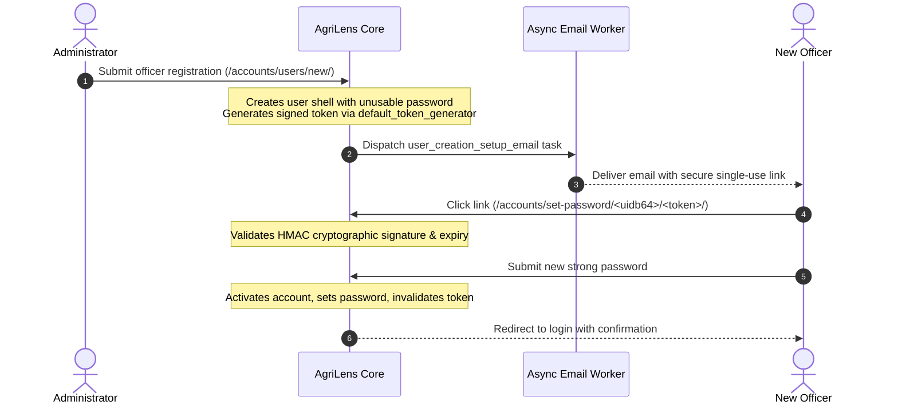

# AgriLens User Management, Roles & Permissions

**Platform:** AgriLens &bull; See Agriculture Through Data  
**Event:** 2026 NISR Big Data Hackathon &bull; Track 1: Agricultural Productivity  
**Document Version:** 2.0 &bull; Updated for Complete Notification, Password Security & RBAC Workflows  

---

## 1. Institutional Role Architecture

AgriLens defines seven primary institutional roles structured according to NISR, MINAGRI, and decentralized administrative governance in Rwanda, plus an unauthenticated Public Visitor tier:

```text
┌────────────────────────────────────────────────────────────────────────┐
│                        AgriLens Institutional Hierarchy                │
├────────────────────────────────┬───────────────────────────────────────┤
│ Tier 1: System Administration  │ 1. Administrator (ADMIN)              │
├────────────────────────────────┼───────────────────────────────────────┤
│ Tier 2: National Headquarters  │ 2. NISR Data Manager (NISR_DATA_MGR)  │
│                                │ 3. Agricultural Analyst (ANALYST)     │
│                                │ 4. National Officer (NATIONAL_OFFICER)│
├────────────────────────────────┼───────────────────────────────────────┤
│ Tier 3: Decentralized Districts│ 5. District Officer (DISTRICT_OFFICER)│
│                                │ 6. Data Entry Officer (DATA_ENTRY)    │
│                                │ 7. Quality Reviewer (REVIEWER)        │
├────────────────────────────────┼───────────────────────────────────────┤
│ Tier 0: Public Access          │ 8. Public Visitor (Unauthenticated)   │
└────────────────────────────────┴───────────────────────────────────────┘
```

### Role Descriptions & Responsibilities

| Role Identifier | Display Title | Jurisdiction | Primary Responsibilities |
| :--- | :--- | :--- | :--- |
| `ADMIN` | Administrator | National | Full institutional governance, user onboarding, role & geographic assignments, security audits, broadcast announcements. |
| `NISR_DATA_MANAGER`| NISR Data Manager | National | Ingestion pipelines, survey weight auditing, batch reconciliation, QA issue tracking, data source validation. |
| `ANALYST` | Agricultural Analyst | National | Yield gap modeling, indicator analytics, benchmark rankings, crop productivity assessments, report exports. |
| `NATIONAL_OFFICER` | National Agricultural Officer | National | Policy decision-support, national bulletin generation, high-level priority crop monitoring. |
| `DISTRICT_OFFICER` | District Agricultural Officer | District Scoped | District-level performance dossiers, local manual observation submission, sector performance monitoring. |
| `DATA_ENTRY_OFFICER`| Data Entry Officer | Scoped / National | Manual field observation drafting, cooperative receipt capture, project survey submission. |
| `REVIEWER` | Quality Reviewer | Scoped / National | Peer review, verification, and authoritative approval/rejection of manual agricultural records. |
| `PUBLIC` | Public Visitor | Unrestricted Read | Public analytics portal, national priority crop overviews, public interactive Rwanda agricultural map. |

---

## 2. Backward Compatibility with Legacy Roles

To preserve 100% backward compatibility with pre-existing database records, sessions, and automated tests, legacy role aliases are explicitly mapped to canonical institutional roles in `User.Role`:

```python
class Role(models.TextChoices):
    # Canonical Institutional Roles
    ADMIN = 'ADMIN', 'Administrator'
    NISR_DATA_MANAGER = 'NISR_DATA_MANAGER', 'NISR Data Manager'
    ANALYST = 'ANALYST', 'Agricultural Analyst'
    NATIONAL_OFFICER = 'NATIONAL_OFFICER', 'National Agricultural Officer'
    DISTRICT_OFFICER = 'DISTRICT_OFFICER', 'District Agricultural Officer'
    DATA_ENTRY_OFFICER = 'DATA_ENTRY_OFFICER', 'Data Entry Officer'
    REVIEWER = 'REVIEWER', 'Quality Reviewer'
    PUBLIC = 'PUBLIC', 'Public Visitor'

    # Legacy Backward-Compatibility Aliases
    POLICY_MAKER = 'POLICY_MAKER', 'Policy Maker (Legacy)'
    EXTENSION_OFFICER = 'EXTENSION_OFFICER', 'Extension Officer (Legacy)'
    RESEARCHER = 'RESEARCHER', 'Agricultural Researcher (Legacy)'
```

### Effective Role Equivalency Engine:
- `POLICY_MAKER` &rarr; Inherits permissions of `NATIONAL_OFFICER` and `ANALYST`.
- `EXTENSION_OFFICER` &rarr; Inherits permissions of `DATA_ENTRY_OFFICER`.
- `RESEARCHER` &rarr; Inherits permissions of `ANALYST`.

---

## 3. Server-Side Security Guards

### A. Conflict-of-Interest & Self-Approval Guard
Officers with reviewer privileges cannot approve their own submissions:
```python
if entry.created_by == request.user and not request.user.is_superuser:
    messages.error(request, "Conflict of Interest Guard: You cannot review or approve your own manual submissions.")
    return redirect('data_management:manual_entry_detail', pk=entry.pk)
```

### B. Administrator Self-Lockout Prevention
Administrators cannot deactivate their own account or remove their own administrative privileges:
```python
if request.user.pk == officer.pk:
    messages.error(request, "Security Guard: You cannot deactivate your own active administrator account.")
    return redirect('accounts:user_detail', pk=officer.pk)
```

### C. Privilege Escalation Prevention
Non-superusers cannot grant `is_superuser` status or assign roles higher than their own clearance level.

---

## 4. Single-Use Password Setup & Self-Service Account Security

AgriLens strictly enforces zero-plaintext credential handling:



### Self-Service Password Security Features:
1. **Self-Service Password Change (`/accounts/password-change/`):** Authenticated users can update their passwords with session preservation and automatic security alerts dispatched across in-app and email channels.
2. **Self-Service Password Reset (`/accounts/password-reset/`):** Comprehensive tokenized forgot-password workflow allowing users to securely recover access via their verified email address.

---

## 5. Multi-Channel Notifications & Communication Authority

AgriLens provides an integrated communication suite with strict permission boundaries:

| Communication Feature | Route | Access Authority | Capability |
| :--- | :--- | :--- | :--- |
| **Notification Center** | `/notifications/` | Authenticated Users | In-app notification drawer, unread counter badges, instant mark-as-read. |
| **Notification Preferences** | `/notifications/preferences/` | Authenticated Users | Manage email/in-app subscription toggles by category (Approvals, Prices, System). |
| **Broadcast Announcements** | `/notifications/admin/` | `ADMIN` Only | Publish platform-wide banners with priority levels (`Normal`, `High`, `Critical`). |
| **Email Delivery Audit & Retry** | `/notifications/admin/` | `ADMIN` Only | Inspect failed/sent transactional emails and trigger immediate delivery retries. |

---

## 6. Security & Audit Trail (`AuditLog`)

Every administrative action, privilege change, password issuance, and manual record approval is permanently recorded in an append-only `AuditLog` table with client IP address, actor ID, target reference, and sanitized JSON details:

```python
AuditService.log(
    action=AuditLog.Action.SUBMISSION_APPROVED,
    actor=request.user,
    target=entry,
    details={'decision': 'approve', 'district': entry.district.name},
    request=request
)
```

Automatic credential sanitization ensures keys such as `password`, `token`, `secret`, and `csrfmiddlewaretoken` are redacted prior to database persistence.

---

## ⚖️ Intellectual Property, License & Usage Policy

> ### ⚠️ STRICT RESTRICTED USE NOTICE
> **All Rights Reserved © 2026 AgriLens Development Team.**
>
> 1. **Non-Commercial & No Personal Profit:**  
>    No individual, entity, or third party is permitted to use, copy, reproduce, monetize, sub-license, or exploit any portion of this codebase, architecture, machine learning models, algorithms, or visual designs for commercial purposes, revenue generation, or personal financial profit under any circumstances.
>
> 2. **Public Hackathon Visibility Disclaimer:**  
>    Although this repository is publicly accessible solely for the purpose of evaluation, review, and judging during the **2026 NISR Big Data Hackathon (Track 1: Agricultural Productivity)**, public availability does **NOT** constitute an open-source license, public domain dedication, or waiver of intellectual property rights.
>
> 3. **Prohibition of Modifications & Derivative Works:**  
>    Any unauthorized modification, alteration, redistribution, fork, decompilation, reverse-engineering, or derivation of this codebase or its underlying assets is strictly prohibited.
>
> 4. **Exclusive Authorization for NISR:**  
>    Operational utilization, institutional adoption, data integration, and platform deployment are **exclusively and solely permitted for the National Institute of Statistics of Rwanda (NISR)** and its officially designated national agricultural partners.
